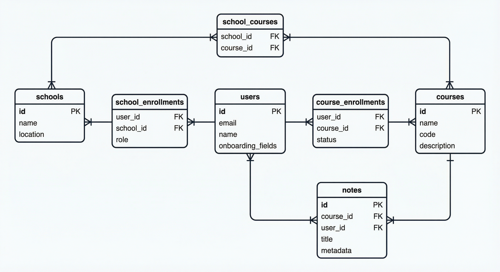
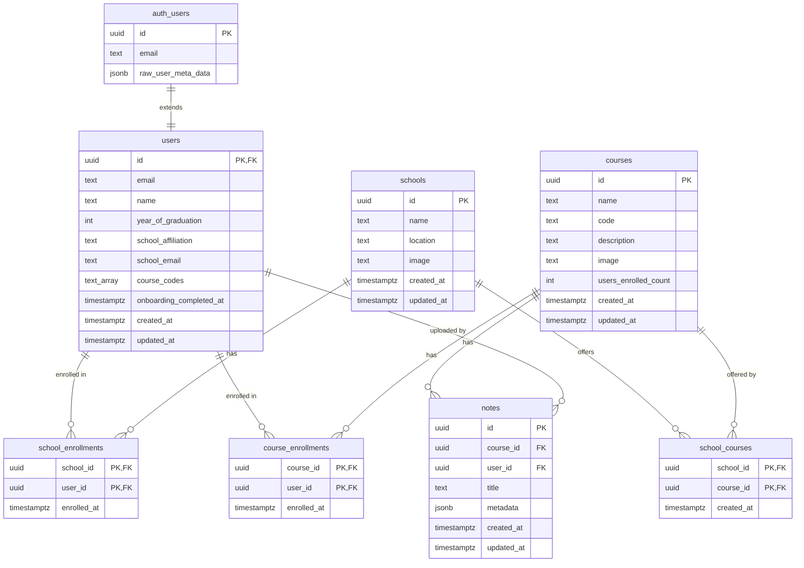

# Noteworks Database Schema

## Mermaid (editable)

## Table summary

| Table | Purpose |
|-------|--------|
| **users** | Profile for each auth user; extends `auth.users` |
| **schools** | Schools/institutions |
| **courses** | Course catalog (name, code, description) |
| **school_courses** | Which courses each school offers |
| **school_enrollments** | Which users are enrolled in which schools |
| **course_enrollments** | Which users are enrolled in which courses |
| **notes** | Notes uploaded to a course by a user |

## Relationships

- **users** ↔ **schools**: many-to-many via `school_enrollments`
- **users** ↔ **courses**: many-to-many via `course_enrollments`
- **schools** ↔ **courses**: many-to-many via `school_courses`
- **notes**: belongs to one **course** and one **user** (uploader)
